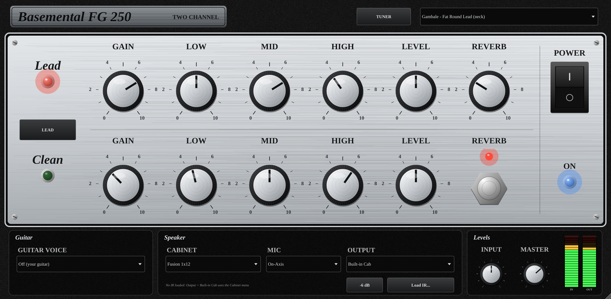

# Basemental FG 250

A two-channel fusion guitar amp plug-in with a built-in strobe tuner, modelled on
the signal chain of the DV Mark FG Little 250 Amplitude (Frank Gambale signature).



## Download

Get the latest installers from the **[Releases page](../../releases/latest)**:

| File | For |
|---|---|
| `BasementalFG250-1.2.0-macOS-Installer.pkg` | **Logic Pro**, GarageBand, MainStage (AU) and other Mac DAWs (VST3). Apple Silicon + Intel |
| `BasementalFG250-1.2.0-Windows-Setup.exe` | Windows DAWs (VST3) and a standalone app |
| `BasementalFG250-1.2.0-Linux.tar.gz` | Linux (VST3 + LV2): unpack and run `./install.sh` |
| `BasementalFG250-REAPER.jsfx` | REAPER, no install needed (no tuner) |

In Logic: Audio FX slot > **Audio Units > Basemental > Basemental FG 250**.

## Features

- Two independent channels (Clean / Lead), each with Gain, Low, Mid, High, Level
- Shared reverb with a stomp footswitch, rocker power switch with blue ON lamp
- 8 built-in cabinets, 3 mic positions, or load your own cabinet IR
- 12 guitar voicings (FG1/FG2, single-coil, humbucker, hollowbody...)
- 9 presets including 8 Gambale-style tones
- Strobe tuner accurate to better than 0.1 cent: auto/manual note, transposing
  keys, cent offset, 8 historical temperaments, Gambale-tuning string guide
- Analogue VU meters for input and output, with peak lights
- Formats: AU, VST3, LV2, Standalone, REAPER JSFX (AAX with Avid's SDK)

## Signal chain

Taken from the block diagram in the FG Little 250 Amplitude user manual:

```
Input -> [Guitar Voice] -> CLEAN: Gain -> Low/Mid/High -> Level --+
                        -> LEAD : Gain -> Low/Mid/High -> Level --+-> Reverb
      -> [Pre Out, 0/-6 dB] -> Class-D power stage -> Cab (built-in or your IR) -> Output
```

| Control | What it does |
|---|---|
| Channel | Clean / Lead (15 ms crossfade, no clicks) |
| Gain | Clean: -6 to +18 dB into a soft, high-headroom stage. Lead: 12-55 dB across two clipping stages, 4x oversampled |
| Low / Mid / High | Post-gain 3-band EQ, 5 = flat. Shelves +/-15 dB, broad mid +/-12 dB |
| Level | Feed to the power stage. Above ~7 it starts pushing the power stage into soft limiting, like a cranked amp |
| Reverb + On/Off | Shared digital reverb (the hardware footswitch toggles it) |
| Guitar Voice | Off, FG1 Neck, FG1 Bridge, FG2, Single-Coil Neck, Single-Coil Bridge, Twang Bridge, Vintage Humbucker Neck, Hot Humbucker Bridge, Archtop Hollowbody (jazz), Semi-Hollow, Superstrat HSS Bridge. Gentle EQ tilts that nudge a DI'd guitar toward those characters; they can't turn one guitar into another. Leave Off for your own guitar's sound |
| Cabinet | Fusion 1x12, 1x12 Open Back, 2x12 Closed Back, 4x12 Closed Back, 1x15 Jazz, 2x10 Vintage Open, 1x12 Jazz Combo, 1x8 Small Combo (used when Output = Built-in Cab) |
| Mic | On-Axis (brightest), Off-Axis (darker, smoother), Close (more low end, proximity effect) |
| Output | Pre Out (no power amp or cab, like the rear jack), Built-in Cab, or User IR (load any cabinet .wav) |
| -6 dB | Pre Out pad, same as the hardware switch |
| Power | Rocker switch; off fades the amp to silence (the tuner keeps working). Blue lamp = on |
| Input / Master | Input trim and master output (dB) |
| VU meters | IN (after the Input knob) and OUT. 0 VU = -18 dBFS, ~300 ms VU ballistics. The red peak light latches at 0 dBFS; click to reset |

### Gambale-style presets

Glassy Clean, Jazz Neck Clean, Edge of Breakup, Sweep Lead, Fat Round Lead
(neck), Singing Sustain, Fusion Crunch Rhythm, Ballad Lead (wet). Each sets
both channels, so the channel button/footswitch gives a matched clean/lead pair.

Frank Gambale hasn't published his amp settings. These are interpretations of
the tones he describes: glassy, expressive cleans and a lead he calls "fat,
round and warm" with long sustain. Lead presets keep gain moderate so sweep
arpeggios stay note-separated. They're for personal use; rename them before
distributing the plug-in, since his name implies an endorsement.

### Strobe tuner

Click **TUNER** in the header. It works like a strobe tuner: the input is
compared against a perfect reference oscillator and the phase drift is
measured, so the bands stand still when you're in tune and drift right
(sharp) or left (flat) at a speed proportional to the error. The x2 and x4
bands magnify small errors.

- Readout: note, cents to 0.1, frequency to 0.01 Hz, flat / in tune / sharp
  lights (green within +/-0.5 cent)
- Reference A: 415-466 Hz in 0.1 Hz steps
- String guide: Chromatic, Standard, **Gambale (A2 D3 G3 C4 E3 A3)**, Half
  Step Down, Drop D, 7-string
- Mute output while tuning (on by default)
- The tuner reads the raw input, ahead of the amp, like a pedal at the front

Measured accuracy (`tests/tuner_test.cpp`): 1,224 synthetic plucked notes from
55 Hz to 1 kHz, +/-50 cents detuned, with decay, noise, string inharmonicity
and weak fundamentals, at 44.1/48/96 kHz and A=440/432. Worst error is
**0.02 cent**. Real-world accuracy is limited by your audio interface's clock,
typically +/-0.03 to 0.09 cent.

Stress tests (`tests/tuner_stress_test.cpp`), all within 0.1 cent (worst 0.06):
88.2 and 192 kHz; low B on 7-strings and B0/E1 on bass; string bends that
settle onto the note; 50/60 Hz mains hum 40 dB below the note; hard-clipped
input; DC offset. Time to lock within 0.1 cent after a pluck: about 110 ms
from the G string up, 150-190 ms on A2/E2, 290 ms on A1, 370 ms on bass E1.
Very loud hum (30 dB below the note) right next to the note's pitch can push
a low-string reading out by ~0.2 cent; fix the hum (cable, ground, single-coil
position) rather than trust the last decimal then.

**FX loop:** a plug-in can't host other plug-ins inside itself. To match the
hardware loop (after the reverb, before the power amp), set Output to
*Pre Out*, insert your delays/modulation after it, then add a cab IR loader.

## What's measured vs. estimated

DV Mark publishes the chain order and control set but not the circuit.
These values in `Source/AmpCore.h` are marked `[VOICING]` and are engineering
estimates, not measurements:

- EQ centre frequencies (clean 110 / 750 / 3200 Hz, lead 100 / 800 / 2800 Hz)
- the lead channel's pre-clip shaping (110 Hz tight high-pass, +5 dB at 850 Hz,
  -4 dB shelf at 3 kHz to soften pick attack) and the clipping curves
- the built-in cab and the guitar voicings

If you can get time with a real FG Little 250, sweep each knob with a sine and
compare. Every one of those numbers is a single constant to change.

## Logic Pro (Audio Unit)

Logic only loads Audio Units, which must be compiled on a Mac:

1. Unzip this folder anywhere (e.g. Documents).
2. Right-click `build-mac.command` > **Open** (the first time macOS asks to confirm).
   If Apple's Command Line Tools aren't installed, it opens their installer:
   click Install, wait, then run the script again.
3. It builds a universal AU + VST3, installs them to
   `~/Library/Audio/Plug-Ins/`, and runs `auval`, the same validation Logic
   runs. Look for **AU VALIDATION SUCCEEDED**.
4. In Logic: a track's Audio FX slot > Audio Units > Basemental > Basemental FG 250.
   If it isn't listed: Logic Pro > Settings > Plug-in Manager > Reset & Rescan Selection.

Easier: use the **installer** instead (see *Installers* below). It needs no
building and installs both the AU and VST3.

The REAPER JSFX version has no tuner (JSFX can't host this kind of GUI);
use the VST3/AU for the tuner.

## REAPER (no build needed)

1. In REAPER: Options > Show REAPER resource path.
2. Copy `JSFX/Fusion250.jsfx` into the `Effects` folder there.
3. On a track: FX > JS > Basemental FG 250.
4. For your own cab IR, set Output to *Power only* and add ReaVerb after it.

## Installers

Every push to GitHub builds installers on Apple, Microsoft and Linux cloud
machines, installs each one there, and checks it (`auval` for the Logic AU).
Pushing a version tag (`git tag v1.2.0 && git push --tags`) publishes them on the
**Releases** page. Builds of untagged pushes are under **Actions** > run > *Artifacts*:

| | File | Installs |
|---|---|---|
| macOS | `BasementalFG250-1.2.0-macOS-Installer.pkg` | AU to `/Library/Audio/Plug-Ins/Components`, VST3 to `/Library/Audio/Plug-Ins/VST3` (universal: Apple Silicon + Intel) |
| Windows | `BasementalFG250-1.2.0-Windows-Setup.exe` | VST3 to `C:\Program Files\Common Files\VST3`, standalone app; uninstaller in Settings > Apps |
| Linux | `BasementalFG250-1.2.0-Linux.tar.gz` | `./install.sh` to `~/.vst3` and `~/.lv2` (`--system`, `--uninstall`) |

The installers aren't signed with a paid Apple/Microsoft developer certificate,
so the first time:
- **macOS:** double-click the .pkg. If macOS says it can't verify the developer,
  click Done, open **System Settings > Privacy & Security**, scroll down and
  click **Open Anyway** next to the Basemental FG 250 message, then run it again.
- **Windows:** if SmartScreen appears, click **More info > Run anyway**.

## Building locally

Requires CMake 3.22+ and a C++17 compiler (Xcode on Mac, Visual Studio 2022 on
Windows, GCC/Clang on Linux). JUCE is downloaded automatically.

```
cmake -S . -B build -DCMAKE_BUILD_TYPE=Release
cmake --build build --config Release
```

Output goes to `build/Fusion250_artefacts/Release/`.

- Mac universal binary: add `-DCMAKE_OSX_ARCHITECTURES="arm64;x86_64"`
- Linux packages: `libasound2-dev libx11-dev libxrandr-dev libxinerama-dev libxcursor-dev libxext-dev libfreetype6-dev libfontconfig1-dev`
- **Pro Tools (AAX):** download the AAX SDK from Avid's developer portal and add
  `-DAAX_SDK_PATH=/path/to/aax-sdk`. Running AAX in a retail Pro Tools also
  requires PACE/iLok signing (free for developers via Avid).

DSP regression test: `build/render_test <folder>` renders test riffs through
every mode at 44.1/48/96 kHz and writes WAVs.

## Licensing

JUCE is free under AGPLv3 or its commercial licence (free "Personal" tier below
a revenue limit). Selling closed-source requires a JUCE licence. The plug-in
name and graphics are original; "DV Mark", "Amplitude" and "Kiesel" are their
owners' trademarks and aren't used in the product name.
