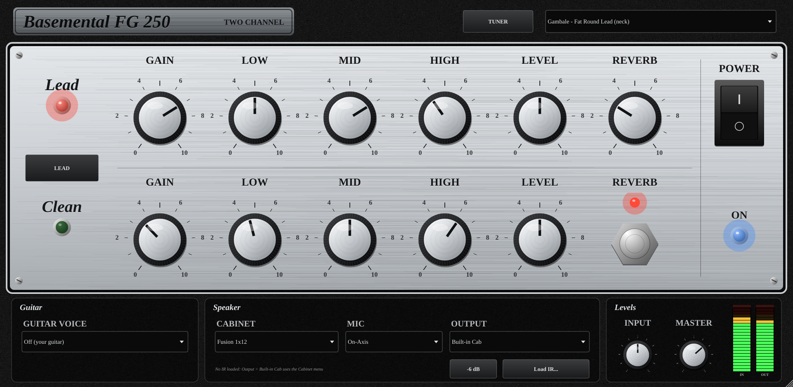

# Basemental FG 250: User Manual

**Version 1.3.0** · two-channel fusion guitar amp plug-in with strobe tuner and FET Stack compressor



---

## 1. Install

Download the installer for your computer from the
[Releases page](https://github.com/cmacjam/Basemental-Frank-Gambale/releases/latest).

### Mac (Logic Pro, GarageBand, MainStage, Ableton, Cubase…)

1. Quit your DAW.
2. Double-click **BasementalFG250-1.3.0-macOS-Installer.pkg**.
3. If macOS says it can't verify the developer: click **Done**, open
   **System Settings › Privacy & Security**, scroll down, click **Open Anyway**
   next to the Basemental message, then run the installer again.
4. Click through the installer. Keep both **Audio Unit** (Logic, GarageBand,
   MainStage) and **VST3** (other DAWs) ticked.

Works on Apple Silicon and Intel Macs. Files go to
`/Library/Audio/Plug-Ins/Components` (AU) and `/Library/Audio/Plug-Ins/VST3`.

### Windows

1. Run **BasementalFG250-1.3.0-Windows-Setup.exe**.
2. If SmartScreen appears, click **More info › Run anyway**.
3. The VST3 goes to `C:\Program Files\Common Files\VST3`; a standalone app
   is added to the Start menu. Uninstall from **Settings › Apps**.

### Linux

Unpack **BasementalFG250-1.3.0-Linux.tar.gz** and run `./install.sh`
(VST3 to `~/.vst3`, LV2 to `~/.lv2`). `./install.sh --uninstall` removes it.

### REAPER (no install)

Copy **BasementalFG250-REAPER.jsfx** into REAPER's `Effects` folder
(**Options › Show REAPER resource path**). The REAPER version has the amp,
cabinets and guitar voices, but not the tuner or FET Stack.

---

## 2. Quick start in Logic Pro

1. Create an **Audio** track and set its input to the interface input your
   guitar is plugged into. Turn on **Input Monitoring** (the "I" button).
2. Click an **Audio FX** slot › **Audio Units › Basemental › Basemental FG 250**.
3. Play and set the **INPUT** knob (bottom right) so the **IN** VU meter swings
   around **0** on your hardest notes. The small red light in the meter's corner
   must stay off.
4. Choose a sound from the **preset menu** (top right), or start from **Init**.
5. Click **TUNER** to tune, **COMP** to open the compressor.

> Not listed in Logic? Quit and reopen Logic. Still missing: **Logic Pro ›
> Settings › Plug-in Manager**, select Basemental FG 250, **Reset & Rescan Selection**.

**Signal flow**

```
Guitar ─► Input ─► Guitar Voice ─► FET Stack (if on) ─► CLEAN or LEAD channel
       ─► Reverb ─► Power amp ─► Cabinet + Mic (or your IR) ─► Master ─► Logic
```

---

## 3. The amp

### Channels

| Control | What it does |
|---|---|
| **LEAD / CLEAN button** | Switches channels (red light = Lead, green = Clean). The switch crossfades, so it never clicks. |
| **GAIN** | Clean: from spotless to edge-of-breakup. Lead: from light crunch to singing sustain. Lead Gain starts at **0.51**; double-click the knob to return there. |
| **LOW / MID / HIGH** | Tone controls after the gain stage. **5 = flat**. Low and High shelve ±15 dB, Mid is a broad ±12 dB. |
| **LEVEL** | Channel volume into the power amp. Above about 7 it starts to push the power stage, like a cranked amp. |
| **REVERB** | Shared reverb amount. The chrome **footswitch** under it turns reverb on/off (red light = on). |
| **POWER** | Rocker switch. Off fades the amp to silence; the blue **ON** lamp shows it's on. The tuner keeps working when power is off. |

Each channel remembers its own settings, so the button gives you a ready
clean/lead pair.

### Bottom panel

| Control | What it does |
|---|---|
| **GUITAR VOICE** | Gentle EQ that nudges your DI toward a pickup or body character: FG1 Neck/Bridge, FG2, single-coil, humbucker, hollowbody, **Semi-Hollow** (default), and more. Choose **Off** to hear your own guitar exactly. |
| **CABINET** | Eight built-in cabinets, from 1x8 to 4x12. Used when Output is *Built-in Cab*. |
| **MIC** | On-Axis (brightest), Off-Axis (darker, smoother), Close (more low end). |
| **OUTPUT** | *Built-in Cab*; *User IR* (your own cabinet impulse, load it with **Load IR…**); or *Pre Out*, which skips the power amp and cabinet so you can use your own. |
| **-6 dB** | Pads the Pre Out by 6 dB. |
| **INPUT** | Trim before everything (-12 to +12 dB). Set this with the IN meter. |
| **MASTER** | Final output level (-24 to +12 dB). |
| **IN / OUT VU meters** | 0 VU = -18 dBFS. Aim for the needle around 0 on loud notes. The red corner light latches if the signal hits 0 dBFS (clipping); click the meter to reset it. |

Double-click any knob to reset it. Drag up/down to turn; hover to see its value.

### Amp presets (top-right menu)

**Init**, plus eight Gambale-style tones: Glassy Clean, Jazz Neck Clean, Edge of
Breakup, Sweep Lead, Fat Round Lead (neck), Singing Sustain, Fusion Crunch
Rhythm, Ballad Lead (wet). Amp presets change the amp only; they don't touch the
FET Stack. They're interpretations of tones Frank Gambale has described, not his
actual settings.

---

## 4. FET Stack compressor

Click **COMP** in the top bar. The FET Stack works like a compressor pedal at the
start of your board: it sits **before the amp**. When it's **off**, your guitar
goes **straight to the amp**, completely untouched.

```
Input ─► Comp 1 ─► Thru ─► Comp 2 ─► Drive ─► Output ─┬─► amp
  └──────────────────── Dry blend ─────────────────────┘
```

### Controls

| Control | What it does |
|---|---|
| **ON** (footswitch) | Turns the FET Stack on/off. Red light = on. |
| **INPUT** | How hard you hit the compressors (-24 to +24 dB). The threshold is fixed, so more Input = more compression. |
| **ATTACK** | 20 µs (instant: flattens the pick) to 50 ms (lets the pick attack through). |
| **RELEASE** | 50 ms (snaps back, can pump) to 1.1 s (smooth, long sustain). |
| **AUTO** | Automatic release: quick after short peaks, slow during sustained playing, so it levels without "breathing". Overrides RELEASE. |
| **KNEE** | 0 dB = hard knee (grabs abruptly), 12 dB = very soft (eases in). |
| **THRU** | Level from Comp 1 into Comp 2: how hard the second compressor works. |
| **DRIVE** | Warm Class-A-style saturation with even and odd harmonics. Adds harmonics, not volume; never hard-clips. |
| **DRY** | Blends your uncompressed signal back in (parallel compression). 0 % = all compressed. |
| **OUTPUT** | Make-up level after compression (-24 to +24 dB). |
| **RATIO** | 2, 3, 4, 6, 8, 12, 20 : 1, or **ALL**: "all buttons in" mode, where the compressor over-compresses (hit harder and it gets *quieter*), with an aggressive, distorted character. |
| **STACKED** | On: Comp 1 feeds Comp 2. Off: Comp 1 only. |
| **LINE DRIVE** | Comp 1 stops compressing and becomes an overdriven preamp: INPUT sets how hard it's driven, DRIVE sets the character. |
| **Gain-reduction meters** | How many dB each compressor is turning the signal down. |

### FET Stack presets (menu at the top of the COMP panel)

FET Stack presets **change only the compressor**, never the amp, and switch the
FET Stack on. Each one's Output is set so it plays at the same loudness as the
compressor switched off, so you can A/B fairly with the ON footswitch.

| Preset | Compression | Good for |
|---|---|---|
| Gentle Always-On | ~3 dB | Light levelling you leave on all the time |
| Jazz Smooth Clean | ~5 dB | Smooth jazz cleans that keep their dynamics |
| Clean Arpeggio Shimmer | ~6 dB | Even arpeggios and chord melodies |
| Country Snap | ~8 dB | Chicken pickin', snappy single notes |
| Funk Rhythm Squash | ~12 dB | Tight, percussive funk rhythm |
| Parallel Punch | ~15 dB | Heavy squash blended 50/50 with your dry tone |
| Sweep Picking Evener | ~8 dB | Even note volume across sweeps and fast picking |
| Fusion Legato Sustain | ~10 dB | Smooth legato lines |
| Singing Lead Sustain | ~16 dB | Long, singing lead notes |
| Stacked British Mode (Zeppelin-style DI) | ~12 dB | Driven preamp into all-buttons compression: raw, pumping rock |
| Sustain for Days (Gilmour-style) | ~14 dB | Soaring solos with endless sustain |
| 16th-Note Chop (Chic-style funk) | ~10 dB | Uniform 16th-note funk strumming |
| LA Studio Clean (80s session snap) | ~8 dB | Punchy studio cleans: the pick passes, the tail is held |
| Wall-to-Wall Acoustic (modern pop) | ~6 dB | Level, upfront strumming (acoustic or clean electric) |
| Front-End Anchor (djent tightener) | ~8 dB | Tightening low-tuned riffs before the Lead channel |

The style presets are inspired by commonly described approaches; they aren't
the artists' or engineers' actual settings and aren't endorsed by them.

**Tips**

- Start from a preset, then adjust **INPUT** for more or less compression and
  **OUTPUT** to match the level.
- Compression depends on how hot your guitar arrives: with a quiet DI, raise
  the FET Stack INPUT; with hot pickups, lower it.
- For more sustain without more squash, add a little **DRIVE**.
- Blend in **DRY** (20–40 %) if a sound feels too flat.

---

## 5. Strobe tuner

Click **TUNER** in the top bar. The tuner reads your guitar **before** the amp.
With **Mute** ticked, the output is silent while you tune.

**Reading it**

- The large note and its octave, the deviation in **cents to 0.1**, and the
  frequency to 0.01 Hz.
- **Strobe bands**: they stand still when you're in tune, drift **right when
  sharp** and **left when flat**, faster the further off you are. The band for
  the note's octave shows the crisp pattern; higher bands magnify small errors.
- **FLAT / IN TUNE / SHARP** lights: green within ±0.5 cent.

Accurate to better than 0.1 cent (measured worst case 0.06 cent). It locks in
about 0.1–0.2 s on guitar notes and up to 0.4 s on low bass notes.

**Settings**

| Setting | What it does |
|---|---|
| **A =** | Reference pitch, 415–466 Hz in 0.1 Hz steps (default 440). |
| **OFFSET** | Shifts every target by up to ±50 cents in 0.1-cent steps. |
| **AUTO / MANUAL** | Auto finds the nearest note. Manual tunes to the note you pick with the 12 note buttons (useful for harmonics or big detunes, up to ±250 cents). |
| **KEY** | Shows notes for C (concert), B♭, F or E♭ instruments. |
| **Temperament + root** | Equal (default), Just, Pythagorean, 1/4-Comma Meantone, Werckmeister III, Kirnberger III, Vallotti, Young II. |
| **String guide** | Lights the string you're tuning: Chromatic, Standard, **Gambale (A2 D3 G3 C4 E3 A3)**, Half Step Down, Drop D, 7-String. |
| **Mute** | Silences the output while the tuner is open. |

**Tips**: pluck one string at a time, let the note ring, and tune *up* to the
note. Very loud mains hum from single-coils can shake the last decimal on low
strings; move or turn slightly to reduce the hum.

---

## 6. Troubleshooting

| Problem | Fix |
|---|---|
| Not in Logic's plug-in list | Quit and reopen Logic, then **Settings › Plug-in Manager › Reset & Rescan Selection**. |
| Mac won't open the installer | **System Settings › Privacy & Security › Open Anyway**, then run it again. |
| No sound | Check **POWER** is on (blue lamp), the tuner is closed (it mutes), and Logic's Input Monitoring is on. |
| Sound is distorted when it shouldn't be | Lower **INPUT** until the IN meter's red light stays off; check LEAD/CLEAN. |
| Too quiet / too loud | Use **MASTER**, or OUTPUT on the FET Stack. |
| Compressor does nothing | Turn up FET Stack **INPUT**; check the ON light. |
| Compressor too strong | Lower FET Stack **INPUT**, raise **DRY**, or try *Gentle Always-On*. |
| Tuner jumps between notes | Mute the other strings and pluck firmly; use **MANUAL** for harmonics. |
| Latency when playing live | Lower Logic's I/O buffer size (**Settings › Audio**). The plug-in adds no latency of its own. |

---

## 7. Specifications

- Formats: AU (macOS), VST3 (macOS, Windows, Linux), LV2 (Linux), Standalone,
  REAPER JSFX; AAX can be built with Avid's SDK
- Mono or stereo input, stereo output (the reverb is stereo)
- Sample rates: 44.1–192 kHz; zero added latency
- Internal 4× oversampling on the saturation stages
- Tuner: strobe (phase-tracking) measurement, better than 0.1 cent
- Source code: <https://github.com/cmacjam/Basemental-Frank-Gambale>

*Basemental FG 250 is an independent project. DV Mark, Kiesel and the other
product and artist names mentioned belong to their owners and are used only to
describe the sounds the plug-in is modelled on.*
